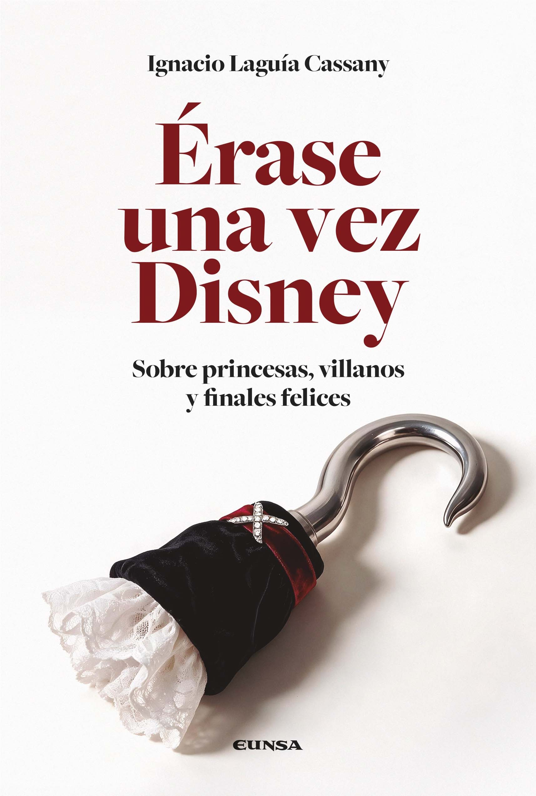

# Retomar hábitos pasados

Me centro en escribir ahora, después de más de un año, este segundo artículo del blog. Lo he empezado realmente para mejorar mi forma de escribir y también para pensar un poco, y también para que tú, lector, te entretengas un rato y, por qué no, te animes a escribir también tú.

He hecho una promesa conmigo mismo para no usar IA para estos artículos. Sería hacer trampas, y quiero intentar ser yo mismo y reflejar algo de mis pensamientos en este blog.

Es curioso lo que ocurre con la tecnología: te promete el avance, la eficacia, la comodidad, pero no vemos lo que tiene la cara B: esa pereza, falta de dominio, falta incluso de humanismo. Lo que empieza por usar la IA para ir más rápido puede acabar en usar la IA para todo: presentaciones, conversaciones con amigos... Claro, porque empiezas con un «Voy a corregir este texto» y acabas con «Escríbeme un texto de 20 líneas sobre XYZ».

¿Y qué podemos hacer ante todo esto? Pues yo creo que autoimponernos retos que nos permitan mostrar nuestra humanidad, porque no tiene alma, solo copia al ser humano.

Últimamente estoy intentando dejar las redes sociales, sobre todo YouTube. La encuentro la más adictiva de todas para mí, ya que te permite ahondar en aficiones y aprender muchas cosas (por cierto, por si no lo he contado antes, me encanta aprender nuevas cosas, pero me cuesta a veces seguirlas con el tiempo). Pero el gran problema que tiene esto es que con tanto YouTube ya no piensas. Por eso estoy intentando llenar esos tiempos que empleaba con YouTube con libros.

Otro problema que me ocurre es empezar muchos libros. Como bromeo con un amigo, la página 60 para mí es el termómetro: si consigo pasarla, tengo más posibilidades de acabar el libro. Ahora estoy leyendo uno sobre las primeras películas de Disney, relacionadas con los cuentos de hadas, Blancanieves, Cenicienta... y me está pareciendo muy entretenido saber de dónde viene todo. Y no es una lectura práctica, como sí que lo es el libro que he puesto en portada de esta entrada, *Hábitos atómicos*. Creo que a veces es bueno leer libros *inútiles,* es decir, que no sirve para algo en concreto, sino para disfrutar, como la propia belleza.  
  
Y hasta aqui el segundo artículo

